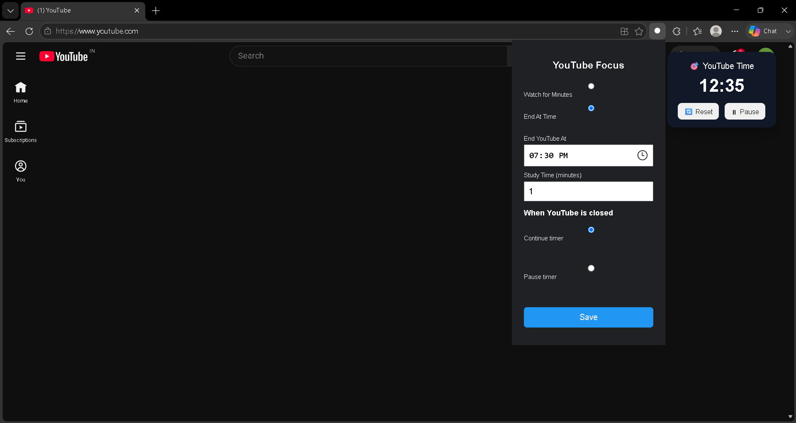
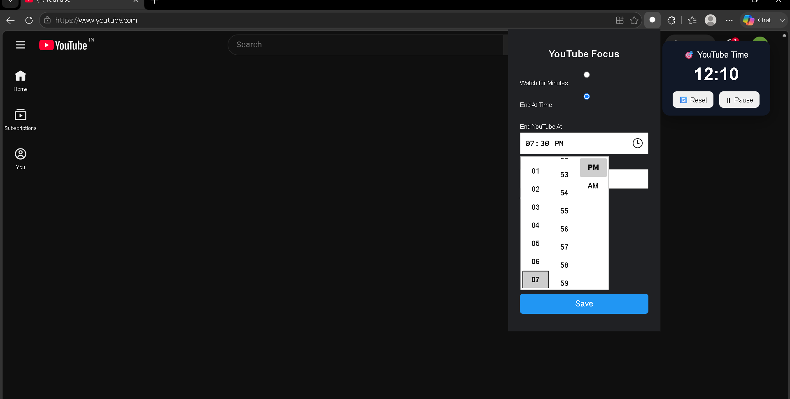
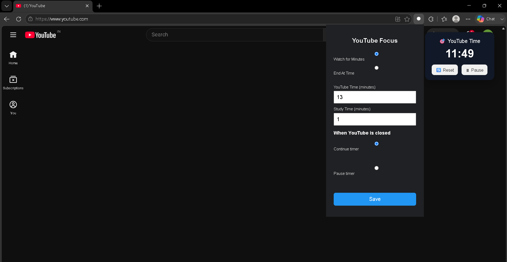

# 🎯 YouTube Focus Timer

A Chrome and Microsoft Edge extension that helps users stay productive by limiting YouTube watch time.

## ✨ Features

- ⏱️ Custom watch timer
- 🚫 Automatic blocking after the timer expires
- 🕒 End-Time Mode (watch until a specific time)
- ⚙️ Easy-to-use popup interface
- 🔄 Automatic timer reset
- 🎓 Designed for students and professionals

## 🛠️ Built With

- HTML
- CSS
- JavaScript
- Chrome Extension APIs

## 📥 Installation

1. Download or clone this repository.
2. Open Chrome or Microsoft Edge.
3. Go to:

```
chrome://extensions/
```

or

```
edge://extensions/
```

4. Enable **Developer Mode**.
5. Click **Load unpacked**.
6. Select this project folder.

## 🚀 Future Improvements

- Daily usage statistics
- Website whitelist
- Password-protected settings
- Focus streak tracking
- Sync settings across devices

## 📄 License

This project is open-source and available for learning and personal use.
## 📸 Screenshots

### Popup



### Timer Running



### Blocked Page


